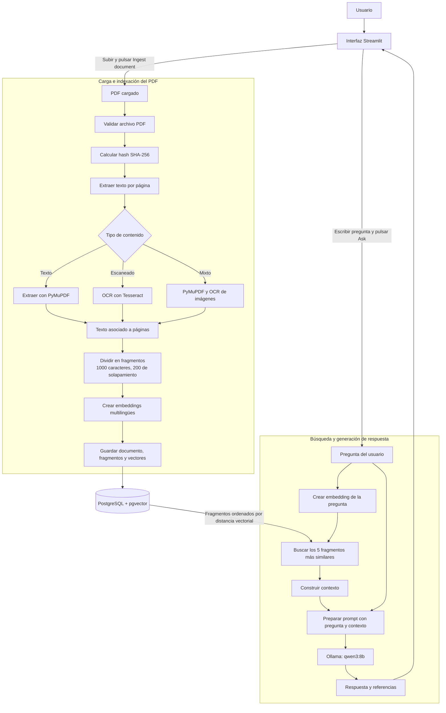

# Cómo funciona Smart Document Auditor

La aplicación permite cargar un PDF, indexar su contenido y hacer preguntas
utilizando los fragmentos más relevantes como contexto para un modelo local.
La interfaz está implementada con Streamlit; PostgreSQL y `pgvector` almacenan
los fragmentos y sus vectores.

## Flujo general

## Qué ocurre en cada etapa

1. **Carga:** Streamlit recibe el PDF y, al iniciar la ingesta, valida el
   archivo y calcula su hash SHA-256.
2. **Extracción:** PyMuPDF lee el texto nativo. Para páginas escaneadas o
   imágenes, Tesseract realiza OCR en inglés y español; los PDF mixtos
   combinan ambos métodos.
3. **Indexación:** el texto conserva el número de página, se divide en
   fragmentos solapados y el modelo
   `paraphrase-multilingual-MiniLM-L12-v2` genera sus embeddings.
4. **Persistencia:** se guardan los metadatos del documento y los fragmentos
   con sus vectores en PostgreSQL. `pgvector` permite compararlos con una
   pregunta.
5. **Búsqueda:** la pregunta se convierte en un embedding y se consultan los
   cinco fragmentos más similares.
6. **Respuesta:** el sistema reúne los fragmentos en el contexto del prompt y
   Ollama genera la respuesta. La interfaz muestra el texto y las referencias
   recuperadas, incluidos documento, página y distancia.

## Componentes principales

| Componente | Función |
| --- | --- |
| Streamlit (`app.py`) | Interfaz para cargar documentos y preguntar |
| PyMuPDF | Extraer texto y procesar páginas PDF |
| Tesseract | Reconocer texto en páginas escaneadas e imágenes |
| Sentence Transformers | Generar embeddings multilingües |
| PostgreSQL + `pgvector` | Guardar documentos, fragmentos y vectores; buscar similitud |
| Ollama | Ejecutar localmente el modelo de generación de respuestas |
